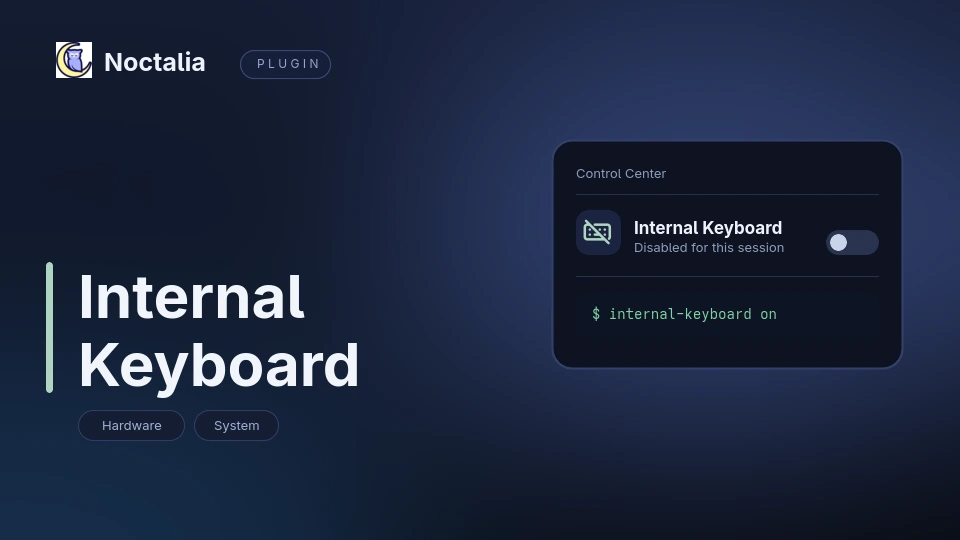

# Noctalia Internal Keyboard — disable the built-in laptop keyboard in niri / Wayland (Noctalia v5 plugin)

A [Noctalia](https://noctalia.dev) v5 plugin that **turns the built-in laptop keyboard off** while
an external keyboard is in use, and back on when you need it — from a control-center tile, an
optional bar widget, an OSD popup, or a TTY.

The switch happens on the **libinput** layer, so the kernel keeps feeding the TTY consoles: if the
internal keyboard is the one that just got disabled, `Ctrl+Alt+F2` plus `internal-keyboard on`
still works. No reboot, no unplugging, no lockout.



```sh
internal-keyboard status     # state=on|off, device=..., available=0|1, nodes=...
internal-keyboard off        # the graphical session stops seeing this keyboard
```

## Features

- **Control-center tile** (highlighted = keyboard disabled) and optional **bar widget**
- **OSD popup** on every toggle, with the usual muted look for the "off" state — can be turned off
- **TTY-safe by design**: only libinput ignores the device, `i8042`/`atkbd` stays untouched, so a
  text console always has a keyboard
- **Any keyboard can be switched**, not just `i8042/serio0`: pick it by name in the settings
  (`internal-keyboard devices` lists the candidates)
- **Boot default is enabled**: the flag lives in `/run` (tmpfs), so a disabled keyboard never
  survives a reboot
- **No polling of the desktop**: the state is read from the udev database, so suspend/resume and
  TTY toggles stay consistent

## Requirements

| Requirement | Why |
| --- | --- |
| `sudo` | The service calls the backend without a password prompt. |
| `udevadm` | Re-announces the keyboard so libinput re-reads the ignore property. |
| `sh` | The backend and the setup script are POSIX shell. |
| A libinput-based compositor | niri, Hyprland, Sway and friends. The switch is on the libinput layer, so Xorg sessions are not supported. |
| One-time root setup | `sudo internal-keyboard/setup.sh` (installs a CLI, one udev rule and one sudoers entry). |

## Install

```sh
git clone https://github.com/Goldppx/noctalia-internal-keyboard.git
cd noctalia-internal-keyboard
./install.sh --setup    # registers the source, enables the plugin, runs the root backend setup
sh tests/smoke.sh       # manifest / entries / translations / backend self-check
```

`setup.sh` is a normal, reviewable script. It lists the keyboards it can see, installs
`/usr/local/bin/internal-keyboard`, renders
`/etc/udev/rules.d/90-internal-keyboard.rules` for the selected keyboard, adds
`/etc/sudoers.d/internal-keyboard` (passwordless `on`, `off`, `toggle`, `select` for that one
root-owned script) and writes `/etc/internal-keyboard/device-name`. `uninstall.sh` reverses it.

Then add the tile under **Settings → Control center → Shortcuts → Internal Keyboard**, or in
`~/.config/noctalia/config.toml`:

```toml
[[control_center.shortcuts]]
type = "goldesquemoon/internal-keyboard:toggle"
```

## Usage

| Entry | Type | What it does |
| --- | --- | --- |
| `toggle` | control-center shortcut | Toggles the keyboard; highlighted means disabled, right click re-reads the backend. |
| `keyboard` | bar widget | Same state and toggle from the bar; the tooltip shows the device. |
| `service` | service | Owns polling, the OSD and the privileged calls. |

No keybind is installed automatically. Bind it yourself (niri example):

```kdl
Mod+Shift+K { spawn-sh "noctalia msg plugin goldesquemoon/internal-keyboard:service all toggle"; }
```

Hyprland:

```ini
bind = SUPER SHIFT, K, exec, noctalia msg plugin goldesquemoon/internal-keyboard:service all toggle
```

Sway:

```ini
bindsym $mod+Shift+k exec noctalia msg plugin goldesquemoon/internal-keyboard:service all toggle
```

From a terminal or TTY:

```sh
internal-keyboard status
internal-keyboard devices    # keyboards that can be switched, * marks the current one
internal-keyboard off
internal-keyboard on
internal-keyboard toggle
```

## Settings

| Setting | Type | Default | Description |
| --- | --- | --- | --- |
| `device` | `string` | empty | Keyboard to switch, by exact name (`internal-keyboard devices` lists them). Empty keeps the keyboard `setup.sh` picked. |
| `show_osd` | `bool` | `true` | Show the OSD popup on every switch. |
| `poll_interval` | `int` | `2000` | How often the tile and widget re-read the state, in milliseconds (minimum 500). |
| `backend` | `string` | `/usr/local/bin/internal-keyboard` | Backend path, kept under the advanced toggle. |

Manifest settings only accept static dropdown options, so the keyboard is named rather than picked
from a list — the setting description carries the command that lists the names.

## How it works

```
tile / widget / keybind ──► service ──sudo -n──► internal-keyboard off
                                                    │
                              /run/internal-keyboard/disabled ◄─┘
                                                    │
                       udevadm trigger --action=remove   (libinput forgets the device)
                       udevadm trigger --action=add      (the rules run again)
                                                    │
         90-internal-keyboard.rules → LIBINPUT_IGNORE_DEVICE=1
                                                    │
                  libinput evdev_device_create() drops it → the compositor never sees it
```

remove+add rather than a plain udev `change` event is deliberate: libinput reads
`LIBINPUT_IGNORE_DEVICE` **only when a device appears** (`evdev_udev_handler` handles `add` and
`remove`), so a `change` event would do nothing. The flag lives in `/run` (tmpfs), which is why the
keyboard always comes back enabled after a reboot.

## FAQ

**Can I get locked out?** Not from the TTY. Only libinput ignores the device; the kernel still
delivers keys to the text console, so `Ctrl+Alt+F2` → `internal-keyboard on` always recovers, even
if the external keyboard is dead.

**Does it survive a reboot?** No — the flag is in `/run`, and enabling at boot is the design.
If you want it to persist you would have to add your own flag outside `/run`.

**Which compositors work?** Anything on libinput: niri, Hyprland, Sway, labwc, mango. Xorg is not
supported, because `xinput disable` is a different mechanism.

**The tile is greyed out.** `available=0`: the device is not present right now (docked laptop,
external keyboard only). `internal-keyboard status` shows which name the plugin is looking for.

**Is passwordless sudo safe here?** The sudoers entry names one root-owned script the user cannot
modify, and only its `on` / `off` / `toggle` / `select` subcommands. `select` validates the name
against the keyboards the kernel currently exposes before it renders the udev rule.

**Can I switch only the numeric keypad or one interface of a combo device?** Yes, if the kernel
exposes it as its own device: `internal-keyboard devices` lists every keyboard interface, and the
`device` setting selects one by name.

## 中文说明

把笔记本内置键盘在图形会话里关掉（用外接键盘时），随时再打开。控制中心磁贴一键切换、可选的栏挂件、
切换时的 OSD 提示。

- 只关 **libinput** 这一层，`i8042`/`atkbd` 不动 —— 内核照样把按键送进 TTY，
  所以键盘被关掉后 `Ctrl+Alt+F2` + `internal-keyboard on` 永远能救回来
- 标志文件在 `/run`（tmpfs），**开机永远默认启用**
- 可以选任意一块键盘：设置里的 `Keyboard` 填设备全名，`internal-keyboard devices` 列出候选
- 后端需要一次 root：`sudo internal-keyboard/setup.sh`（一个 CLI + 一条 udev 规则 + 一条限定了
  子命令的 sudoers 条目）
- 依赖：`sudo`、`udevadm`、`sh` + libinput 系合成器（niri / Hyprland / Sway）

## Search terms / 关键词

Noctalia plugin, Noctalia v5, disable built-in keyboard, disable laptop keyboard, turn off internal
keyboard, external keyboard, libinput, LIBINPUT_IGNORE_DEVICE, udev rule, evdev, Wayland, niri,
Hyprland, Sway, control-center tile, bar widget, OSD, laptop keyboard switch, Arch Linux, CachyOS,
禁用内置键盘, 关闭笔记本键盘, 外接键盘, 键盘开关

## Links

- Plugin source: [`internal-keyboard/`](internal-keyboard/)
- Noctalia: <https://noctalia.dev>
- Community plugin store: <https://noctalia.dev/plugins>
- Community pull request (draft): <https://github.com/noctalia-dev/community-plugins/pull/1267>

## License

MIT
